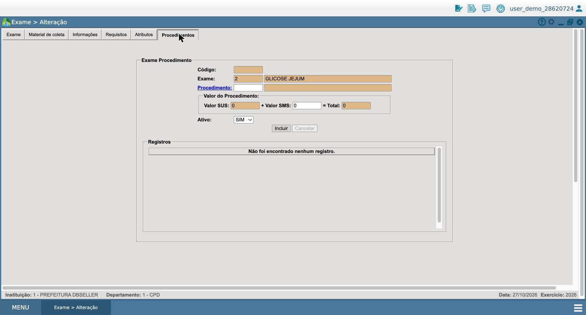
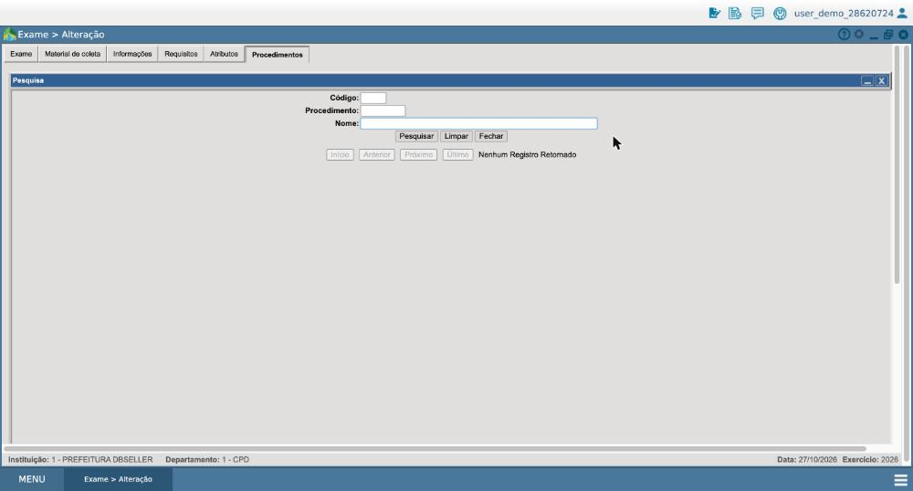
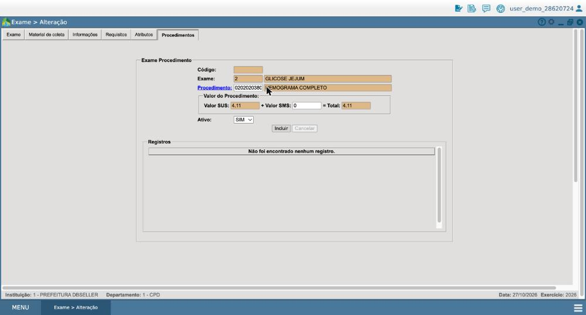

# Ponderada de Design: IA que continua útil quando erra

## 1. A funcionalidade e onde ela fica na jornada

**Jornada:** cadastro de exame laboratorial no e-Cidade (DB:SAÚDE › Laboratório › Cadastros › Exame), a mesma da ponderada S2.

**Etapa:** 5 do blueprint as-is da S2, "completa abas 2–6", na **aba Procedimentos** do exame, onde o servidor vincula o exame a um procedimento da tabela SIGTAP. Esse vínculo é o cruzamento **X1 (Exame ↔ SIGTAP)**: ele define o valor SUS do exame e o faturamento do laboratório (BPA), e é uma das condições para o exame poder ser agendado.

**Funcionalidade proposta:** *Sugestão de procedimento SIGTAP*. A partir da descrição e da sigla do exame (e, se houver, dos sinônimos), a IA sugere o procedimento SIGTAP da competência vigente que corresponde ao exame, mostrando de onde tirou a sugestão e o quanto está segura. O servidor confirma, troca ou ignora. Nada é gravado sem a confirmação dele.

## 2. Por que IA e não uma regra fixa

**O atrito.** Para vincular o procedimento, o servidor abre a pesquisa de procedimentos (`func_sau_procedimento.php`) e precisa encontrar, entre milhares de itens do grupo 02 (diagnóstico), o procedimento certo. A busca por nome é uma **comparação de prefixo**: `sd63_c_nome ilike 'texto%'`. Ela só encontra o procedimento se o servidor digitar exatamente o começo do nome oficial.

O problema é que o laboratório nomeia o exame de um jeito e a tabela SIGTAP, de outro. No demo, a pesquisa traz **4.536 procedimentos** de todos os grupos, inclusive medicamentos e cirurgias. O exame **GLICOSE JEJUM** está cadastrado e **sem nenhum procedimento vinculado** (print 01).

**Teste da busca no demo (27/10/2026).** Busquei pelo campo Nome da pesquisa de procedimentos, só lendo, sem gravar nada:

| O servidor digita | Resultado da busca atual | Procedimento que ele precisava |
|---|---|---|
| HEMOGRAMA | 1 resultado: 0202020380 HEMOGRAMA COMPLETO | O mesmo (o nome do exame coincide com o começo do nome oficial) |
| GLICOSE JEJUM | **Nenhum registro** (print 03) | 0202010473 DOSAGEM DE GLICOSE |
| GLICOSE | **Nenhum registro** | 0202010473 DOSAGEM DE GLICOSE |
| GLICEMIA | 1 resultado: 0214010015 GLICEMIA CAPILAR, **outro exame** (teste rápido de ponta de dedo) | 0202010473 DOSAGEM DE GLICOSE |
| TSH | **Nenhum registro** | 0202060250 DOSAGEM DE HORMONIO TIREOESTIMULANTE (TSH) |
| COLESTEROL HDL | **Nenhum registro** | 0202010279 DOSAGEM DE COLESTEROL HDL |
| CREATININA | **Nenhum registro** | 0202010317 DOSAGEM DE CREATININA |
| PLAQUETAS | **Nenhum registro** | 0202020029 CONTAGEM DE PLAQUETAS |
| URINA | **Nenhum registro** | 0202050017 ANALISE DE CARACTERES FISICOS, ELEMENTOS E SEDIMENTO DA URINA |

Só encontra o procedimento quem já sabe começar pela palavra certa ("DOSAGEM DE…", "CONTAGEM DE…", "ANALISE DE…"). Ou seja, quem já conhece o vocabulário do SIGTAP.

**Achado que agrava o atrito.** Quando a busca devolve **um único resultado**, a tela **preenche o procedimento sozinha**, sem pedir confirmação. Ao testar "HEMOGRAMA" a partir do exame GLICOSE JEJUM, o formulário ficou com HEMOGRAMA COMPLETO e valor SUS de R$ 4,11 já preenchidos (print 04; não cliquei em Incluir). Com "GLICEMIA", o mesmo aconteceria com GLICEMIA CAPILAR, que é outro exame. Ou seja, o sistema atual já "sugere" sem mostrar a origem nem pedir confirmação. É exatamente o comportamento que uma IA bem desenhada precisa evitar.

| Print 01: exame sem procedimento | Print 03: busca sem resultado | Print 04: resultado único preenchido sozinho |
|---|---|---|
|  |  |  |

Quando a busca falha, o servidor precisa saber o código de cabeça ou procurar fora do sistema. Como a tabela muda a cada competência mensal, o que ele sabia pode deixar de valer.

**Comparação com alternativas sem IA**

| Alternativa | Como funcionaria | Por que perde para a IA |
|---|---|---|
| Busca atual por prefixo | O servidor digita o começo do nome oficial | Exige conhecer o vocabulário do SIGTAP, que é justamente o que falta |
| Busca por "contém" (`%texto%`) | Encontra o termo em qualquer posição | Melhora casos como "GLICOSE", mas não resolve siglas (TSH), sinônimos (glicemia × glicose) nem ordem de palavras. Também devolve listas longas sem dizer qual é o certo |
| Tabela de/para mantida à mão | Uma lista "nome do laboratório → código SIGTAP" | Cada laboratório usa nomes diferentes, e a tabela SIGTAP muda todo mês. Alguém precisa manter a lista, e ela envelhece em silêncio |
| **IA (proposta)** | Compara o significado da descrição, sigla e sinônimos com os nomes e descrições oficiais da competência vigente | Lida com siglas, sinônimos e variações sem lista mantida à mão, e consegue dizer quando não tem certeza |

**Limite honesto.** A busca por "contém" é barata e resolve parte do problema. Ela deve existir de qualquer forma, como caminho manual quando a IA estiver fora (estado "indisponível"). A IA se justifica pelo que a regra não alcança: siglas, sinônimos e a escolha entre candidatos parecidos.

## 3. Matriz de estados

| Estado | O que acontece | Cenário de exceção do projeto | O que o servidor vê | O que pode fazer | Como conclui sem a IA |
|---|---|---|---|---|---|
| **Sucesso** | A IA encontra um procedimento com alta confiança | — (CS-01/CS-02, cadastro normal) | O procedimento sugerido, com código, nome oficial, competência e o motivo da sugestão | Confirmar, trocar ou ignorar | Busca manual continua disponível ao lado |
| **Incerteza** | Dois ou mais procedimentos plausíveis, sem um claro vencedor | [pendente] CS-04 (ativação incompleta): sem procedimento certo, o exame fica ativo e não agendável | Os candidatos lado a lado, com a diferença entre eles e **o que conferir**. Ex.: para "GLICOSE JEJUM", DOSAGEM DE GLICOSE (sangue, laboratório) × GLICEMIA CAPILAR (ponta de dedo, teste rápido): "confira o material de coleta do exame" | Escolher um, pedir mais opções ou buscar manualmente | Busca manual pré-preenchida com o termo |
| **Erro da IA** | A IA sugere com confiança um procedimento errado (ex.: GLICEMIA CAPILAR para um exame de glicose no sangue), e o servidor percebe na hora ou depois | [pendente] ATAM §5.2.3: o sistema aceita o procedimento sem conferir; o erro só aparece no faturamento ou no agendamento | A sugestão marcada como "sugerida pela IA", com origem visível, e um histórico do vínculo | Trocar o procedimento, **desfazer** o vínculo (reversão) e marcar a sugestão como errada (correção que alimenta a IA) | Busca manual; o vínculo anterior é restaurado |
| **Falha parcial** | A IA responde, mas com a base desatualizada ou sugere um procedimento que foi desativado na competência | CS-06 (desativação de procedimento) | Sugestão com aviso: "baseada na competência MM/AAAA; o procedimento X foi desativado" | Ver a substituição indicada, se houver, ou buscar manualmente | Busca manual filtrada pela competência vigente |
| **Serviço indisponível** | O serviço de IA não responde | [pendente] §8.2 (queda de serviço interno, ainda vazia no projeto) e ATAM §5.2.4 (sem monitoramento nem aviso) | Aviso discreto: "Sugestão indisponível no momento" | Seguir com a busca manual, sem perder o que já preencheu | É o próprio fluxo atual, com a busca melhorada por "contém" |

[pendente] Combinar com o grupo os IDs dos cenários da §8.2 do Projeto.md para usar os mesmos na matriz.

## 4. Telas

[pendente] Depois do slide da S3. Uma tela por estado, com as diretrizes de interação humano-IA de Amershi et al. (2019) marcadas: fonte da resposta, correção, reversão e controle humano.

## 5. Salvaguardas para o dado

**Quem responde pela decisão.** O servidor responsável pelo cadastro do exame. A IA só sugere: o vínculo só é gravado quando ele confirma, e a tela deixa isso explícito ("você está vinculando…"). A conferência do procedimento continua sendo responsabilidade do laboratório, como hoje, porque o vínculo define o valor faturado ao SUS.

**O que fica registrado.** Para cada vínculo: quem confirmou, quando, se a origem foi sugestão da IA ou busca manual, qual sugestão foi feita, a confiança mostrada, a competência SIGTAP usada e, em caso de troca ou reversão, o valor anterior. O e-Cidade já registra alterações com `db_acount`; o registro novo complementa isso com a origem da decisão.

**Dados que a IA não pode usar (LGPD).** O cadastro de exame não contém dado de paciente, e a IA deve continuar assim. Ela usa só dados do catálogo: descrição, sigla e sinônimos do exame e a tabela SIGTAP pública. Ela **não pode** usar requisições, resultados, prontuários ou qualquer dado de paciente, que são dados pessoais sensíveis (LGPD, art. 5º, II, e art. 11), nem dados de servidores além do necessário para o registro de auditoria.

## 6. Declaração de uso de IA

[pendente] Ao final.
