# Ponderada de Design S3: estados de falha na Requisição de Exames

**Jornada:** cadastro e requisição de exame laboratorial no e-Cidade (DB:SAÚDE › Laboratório), a mesma das ponderadas anteriores.
**Telas trabalhadas:** Requisição de Exames (tela principal) e Cadastro de Exame (ir além), nas versões to-be com o Serviço de Prontidão do Exame. Versão navegável: `telas/telas.html`.

**Sobre esta ponderada.** Quase todo sistema é desenhado pensando no caminho em que tudo dá certo, mas é quando algo dá errado que o usuário mais precisa da tela: ele precisa entender o que aconteceu, não perder o que já fez e saber como seguir. Por isso, esta ponderada parte de um problema real encontrado na análise heurística da S2 e redesenha a tela onde ele aparece, escrevendo cada situação de falha possível e construindo a tela com o Design System do governo (DS gov.br), para que erros, avisos e confirmações apareçam do mesmo jeito que em qualquer serviço público.

**Como ler este documento.** A seção 1 explica de onde veio a escolha da tela; a seção 2 descreve, um por um, os estados de falha e como a tela trata cada um; a seção 3 justifica os componentes do DS usados; a seção 4 mostra as telas; a seção 5 registra o que a IA errou ao gerar as telas e o que foi corrigido; a seção 6 traz uma segunda tela, com um tipo de erro diferente; e a seção 7 declara como a IA foi usada.

**Alguns termos que aparecem ao longo do texto:**
- **Blueprint as-is e to-be:** o mapa da jornada como ela é hoje (as-is) e como ela fica depois da mudança proposta (to-be), ambos feitos na S2.
- **Serviço de Prontidão do Exame:** a mudança proposta na S2. Hoje, a regra que decide se um exame pode ser requisitado está escondida num filtro da busca; no to-be, ela vira um serviço próprio, que sabe dizer se o exame está pronto e, se não estiver, o que falta.
- **DS gov.br:** o Padrão Digital de Governo, o conjunto oficial de componentes visuais (mensagens, botões, campos, tabelas) que os serviços públicos devem usar.

---

## 1. Origem da escolha

Esta seção explica por que escolhi esta tela e não outra. A escolha não é livre: ela precisa partir de um problema que eu mesma encontrei na avaliação heurística da S2 e precisa estar num ponto da jornada que o blueprint to-be já prevê mudar, para que a tela nova seja a continuação do que foi analisado antes, e não um desenho solto.

### 1.1 O problema da análise heurística

| ID (S2) | Heurística | Severidade | O problema |
|---|---|:---:|---|
| **P1** | H9 Reconhecer, diagnosticar e recuperar erros · H1 Visibilidade do status | **4** | Na Requisição de Exames, a busca por um exame ATIVO retorna "Nenhum Registro Retornado". A tela não diz que o exame existe, nem por que ele não aparece, nem quem pode resolver. |

Escolhi o P1 porque ele é o único problema de severidade 4 da minha avaliação e porque é nele que desembocam os outros problemas graves (P2, P3 e P4, todos de severidade 3): o exame fica incompleto no cadastro e quem descobre é a recepção, no balcão, na frente do paciente.

**Evidência nova (30/10/2026).** Voltei ao demo com o usuário de demonstração, no departamento **1 - CPD**, e abri a pesquisa de exames da requisição. Mesmo **sem nenhum filtro**, a pesquisa responde "Nenhum Registro Retornado" (print 02). Para esse usuário, nenhum exame existe. Pela análise do grupo (§5.2.3 e §5.2.4 do Projeto.md), a busca só lista exames que cumprem ao mesmo tempo quatro condições (exame ativo, procedimento SIGTAP ativo, vínculo ativo com setor e laboratório ligado ao departamento do usuário), e a causa provável aqui é a última. Fica registrado como hipótese: não conferi no cadastro do laboratório qual condição falha para esse departamento, e é justamente por isso que o problema é grave, porque a própria tela não deixa descobrir.

| Print 01: tela atual de lançamento | Print 02: pesquisa vazia, sem filtro |
|---|---|
| 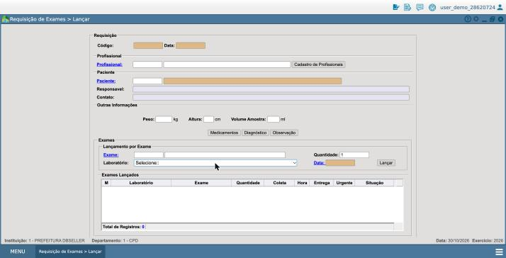 | 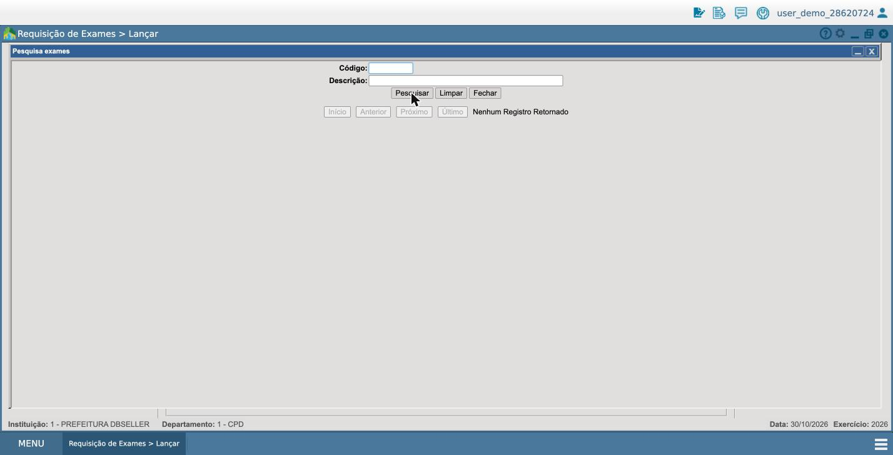 |

O ATAM do grupo reforça o diagnóstico: o filtro em `lab4_agendar.RPC.php` "esconde em vez de rejeitar" e não gera motivo nem aviso, e o único aviso que a requisição já tem (`verificaExameAtivo`) olha só se o exame está DESATIVADO, ignorando procedimento, setor e laboratório.

### 1.2 Onde a tela entra no blueprint to-be

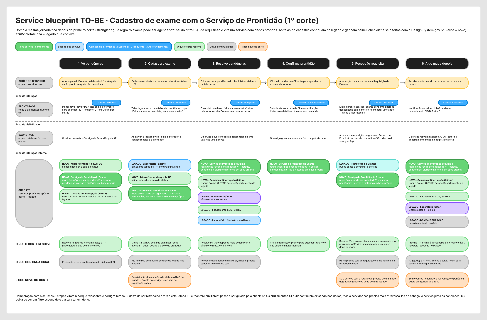

A tela é a **etapa 5, "Recepção requisita"**, do blueprint to-be da S2:

- **Frontstage (camada 1, Essencial):** "exame pronto aparece; exame pendente aparece desabilitado com o motivo".
- **Backstage:** a busca da requisição pergunta ao Serviço de Prontidão em vez de usar o filtro SQL (o desvio do strangler fig).
- **Cruzamento X3:** é o ponto mais acoplado da jornada, onde exame, SIGTAP, setor e departamento só se encontram.
- **Riscos novos que o próprio to-be já apontava:** "se o serviço cair, a requisição precisa de um modo degradado" (etapa 5) e "sem eventos no legado, a reavaliação é periódica: existe uma janela de atraso" (etapa 6). Esses dois riscos viraram estados da tela (ver seção 2).

### 1.3 Para quem e em que momento

**Quem usa:** o servidor da recepção, que monta a requisição de exames com o paciente na frente dele (a Daiane, na jornada da Saúde).
**Momento:** depois de identificar profissional e paciente, quando ele busca e lança os exames pedidos.
**O que ele precisa:** saber, na hora, se cada exame pode ser requisitado; se não puder, saber o motivo e o que fazer, sem perder o que já preencheu e sem travar os outros exames do paciente.

---

## 2. Tratativa de erro: os estados da tela

Esta é a parte central da ponderada. Uma mesma tela pode estar em situações bem diferentes: tudo deu certo, o sistema não tem certeza, o sistema errou, só uma parte funcionou, ou o serviço caiu. Para cada uma dessas situações, chamadas aqui de **estados**, descrevo o que aconteceu, de onde vem o problema, o que a tela diz para o usuário, o que ela preserva do que ele já fez e como ele consegue seguir com o trabalho.

Os três tipos de erro vêm do Google PAIR, adaptados no slide: **sistema** (não responde ou responde mal), **entrada** (a entrada não permite resposta útil) e **contexto** (o sistema presume algo errado sobre a situação). Cada estado usa um dos quatro tipos de **Mensagem do DS gov.br**: sucesso, atenção, erro e informação. E todo alerta aparece **sempre no mesmo lugar**: logo abaixo do título da tela, antes de qualquer campo. Assim a pessoa aprende onde olhar e não precisa procurar a mensagem pela tela.

### 2.1 Resumo

| Estado | Mensagem do DS | Tipo de erro | De onde vem |
|---|---|---|---|
| Sucesso | Sucesso | — | Fluxo normal, etapa 5 do to-be |
| Atenção (incerteza) | Atenção | Contexto | Risco "janela de atraso" do to-be (etapa 6) · PS3/PS8 do ATAM |
| Erro | Erro | Contexto | **P1** · cruzamento X3 · §5.2.3 e §5.2.4 do ATAM |
| Informação (falha parcial) | Informação | Sistema | Convivência legado + serviço (to-be, etapa 5) · PS6 do ATAM |
| Indisponível | Erro | Sistema | Risco "se o serviço cair, modo degradado" do to-be (etapa 5) |

### 2.2 Cada estado

**Sucesso**
- **O que aconteceu:** o exame está pronto e foi adicionado à requisição.
- **O que a tela diz:** "Hemograma completo adicionado. Coleta em 31/10."
- **Como segue:** o exame aparece em "Exames nesta requisição" e a busca fica livre para o próximo.

**Atenção (incerteza)**
- **O que aconteceu:** o Serviço de Prontidão reavalia os exames de tempos em tempos, porque o legado não avisa quando algo muda. O cadastro do TSH mudou depois da última verificação, então a informação "pronto" pode estar desatualizada.
- **Tipo:** contexto. O sistema mostraria como certo um dado que talvez já não valha.
- **O que a tela diz:** "A disponibilidade do TSH pode ter mudado. O cadastro foi alterado depois da última verificação (14h05)."
- **O que preserva:** tudo o que já foi adicionado.
- **Como segue:** o botão em destaque é "Verificar agora"; "Adicionar mesmo assim" fica como opção secundária.
- **Regra do slide:** a incerteza diz por que é incerta e o que conferir, em vez de só "dado provisório".

**Erro**
- **O que aconteceu:** o exame existe e está ativo, mas não cumpre uma das condições de prontidão (Glicose jejum está sem procedimento SIGTAP). Hoje o filtro simplesmente o esconde (P1).
- **Tipo:** contexto. O sistema aplica uma regra sem avisar, e a recepção conclui que o exame "não existe".
- **O que a tela diz:** "Glicose jejum não pode ser requisitado agora. Falta o procedimento SIGTAP no cadastro. O Laboratório Central já foi avisado."
- **O que preserva:** paciente, solicitante e os exames já adicionados.
- **Como segue:** o exame aparece com a tag "Pendente" e o botão desabilitado; os outros resultados continuam disponíveis. A recepção não precisa descobrir a causa nem abrir chamado.

**Informação (falha parcial)**
- **O que aconteceu:** de cinco exames, três foram salvos e dois não, porque o Laboratório (legado) não respondeu. Cada gravação é separada (PS6), então uma parte pode dar certo e outra não.
- **Tipo:** sistema.
- **O que a tela diz:** "3 de 5 exames salvos. TSH e Creatinina não foram salvos porque o Laboratório não respondeu."
- **O que preserva:** os três exames salvos e os dados dos dois que faltam, marcados "Não salvo".
- **Como segue:** o botão principal passa a ser "Tentar os 2 de novo", e "Salvar requisição" vira secundário. Não recomeça do zero.

**Indisponível**
- **O que aconteceu:** o Serviço de Prontidão não responde. A busca volta ao filtro antigo, que é o plano B do strangler fig.
- **Tipo:** sistema.
- **O que a tela diz:** "Não conseguimos verificar os exames agora. A busca está no modo antigo e não mostra pendências. Sua requisição continua salva aqui."
- **O que preserva:** a requisição em andamento.
- **Como segue:** continua buscando e adicionando, ou clica em "Tentar de novo".
- **Limite (degradação graciosa):** nenhum exame recebe a tag "Pronto" sem verificação. Degradar não é fingir que funciona.

---

## 3. Aplicação do DS gov.br

Depois de decidir o que a tela precisa dizer em cada estado, faltava decidir como ela mostra isso. Aqui entra o DS gov.br: em vez de inventar um jeito próprio de mostrar erro ou aviso, a tela usa os componentes oficiais, porque assim o servidor reconhece o significado de cada mensagem pelo mesmo padrão que já vê em outros serviços públicos.

**Como a tela foi feita.** Em HTML, usando o pacote oficial que está na pasta `DS_govbr_completo/`: o CSS do DS (`@govbr-ds/core` 3.7.0), a fonte **Rawline** e os ícones **Font Awesome 6**. A marcação de cada componente segue os exemplos oficiais da pasta (`dist/components/<nome>/examples`). Para ver, abra `telas/telas.html` no navegador e escolha a tela e o estado nos botões do topo. O cabeçalho azul imita a janela do e-Cidade, porque no to-be a parte nova convive com o legado.

### 3.1 Componentes e por que cada um

| Componente do DS | Onde aparece | Por que este |
|---|---|---|
| **Mensagem** (`br-message`): sucesso, atenção, erro e informação | Em todos os estados | É o componente do DS para comunicar o resultado de uma ação ou o estado de uma área. Fica **sempre no mesmo lugar**, logo abaixo do título, em todos os estados das duas telas. Quando há duas mensagens, o resultado da ação vem primeiro e o aviso permanente depois |
| **Estado de erro do campo** (`br-input danger`) | Campos do cadastro com erro | O campo fica com a borda vermelha e o rótulo ganha "(corrigir)", para a pessoa achar onde mexer. O texto do erro fica no alerta do topo, e não embaixo do campo, para manter um lugar só para os alertas |
| **Tag** (`br-tag`, densidade pequena) | Situação de cada exame: Pronto, Pendente, A confirmar, Salvo, Não salvo, Ativo | Mostra um estado curto de um item, sem ação |
| **Botão** (`br-button`) primário, secundário e terciário | Salvar, Tentar de novo, Verificar agora, Adicionar, Cancelar | O DS define a ênfase pela hierarquia da ação. **Um primário por vez**: na falha parcial, "Tentar os 2 de novo" vira o primário e "Salvar requisição" passa a secundário |
| **Input com ícone** (`br-input`) | Busca de exame e campos do cadastro | Campo padrão, com rótulo visível |
| **Abas** (`br-tab`) | Cadastro de exame | As abas do cadastro legado, no padrão do DS |

### 3.2 Cor nunca sozinha

Cada estado é reconhecível sem cor: as mensagens têm ícone próprio (✓, ⚠, ✕, i) e texto, e as tags têm ícone + palavra. Na tag "A confirmar", o texto é escuro sobre o amarelo para garantir contraste (e-MAG).

### 3.3 Estrutura, espaço e hierarquia

- **Uma coluna, de cima para baixo:** título, quem é o paciente, busca, resultados, exames da requisição e botões. É a ordem em que a recepção trabalha, então a tela não precisa de painéis laterais nem de caixas extras.
- **Um lugar só para os alertas:** toda mensagem aparece logo abaixo do título, nas duas telas e em todos os estados. O item ou campo com problema é marcado no próprio lugar (tag ou borda vermelha), mas a explicação fica sempre no mesmo ponto.
- **Pouca informação de cada vez:** cada exame mostra só nome, laboratório e situação. O resto não ajuda a decidir na hora.
- **Hierarquia pelas classes do DS:** título da tela com `text-up-03` em semibold, subtítulo em semibold, metadados em cinza (`text-gray-60`) e menores (`text-down-01`).
- **Espaçamento em múltiplos de 8 px**, com as classes utilitárias do DS (`mt-*`, `mb-*`) e 32 px separando os blocos principais.
- **Componentes do DS sem alteração:** o tamanho e o estilo das mensagens, tags, botões e abas são os do DS. O CSS próprio se limita à barra do e-Cidade e ao espaçamento entre as linhas.

### 3.4 O que o DS não cobria e como decidi

| Lacuna | Decisão |
|---|---|
| Não há tag de **status com texto** para "Pronto / Pendente": a tag "status" do DS é só um ponto colorido | Usei a tag de texto com as cores de feedback do próprio DS e ícone, para não depender da cor |
| Não há cor **neutra** para "Não salvo" | Tag cinza com ícone. Não usei vermelho porque não é erro do exame, e não usei verde porque não foi confirmado |
| Não há padrão para **item bloqueado com motivo** | O item aparece na lista com a tag "Pendente" e o botão desabilitado, e o motivo vai para o alerta do topo, que cita o exame pelo nome. O slide sugere a mensagem "junto à linha com problema"; preferi a consistência de um lugar só para os alertas, e a tag faz a ligação visual com a linha |
| Não há componente de **estado de salvamento** ("Rascunho salvo às 14h31") | Texto pequeno em cinza junto aos botões, sem componente novo |

## 4. Telas

Esta seção mostra o resultado visual: a tela de Requisição de Exames em cada um dos estados descritos na seção 2. As imagens estão no tamanho de uma tela de computador (1440 × 900), com a moldura do e-Cidade em volta: barra do usuário, título da janela, rodapé com instituição e departamento e o botão MENU. Na versão navegável (`telas/telas.html`), cada estado vem com um quadro ao lado que explica o componente do DS, o tipo de erro, de onde vem e o que a tela faz.

| Estado | Imagem |
|---|---|
| Sucesso · Mensagem de sucesso | 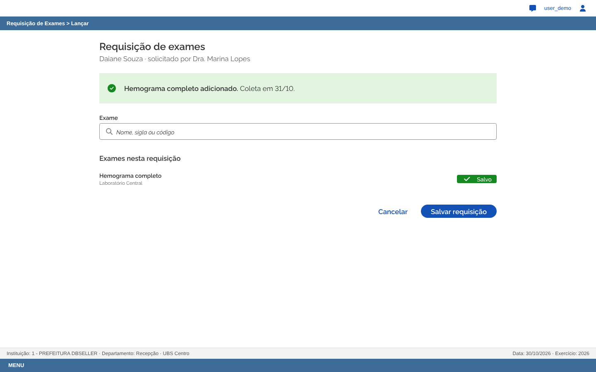 |
| Atenção · Mensagem de atenção · tipo contexto | 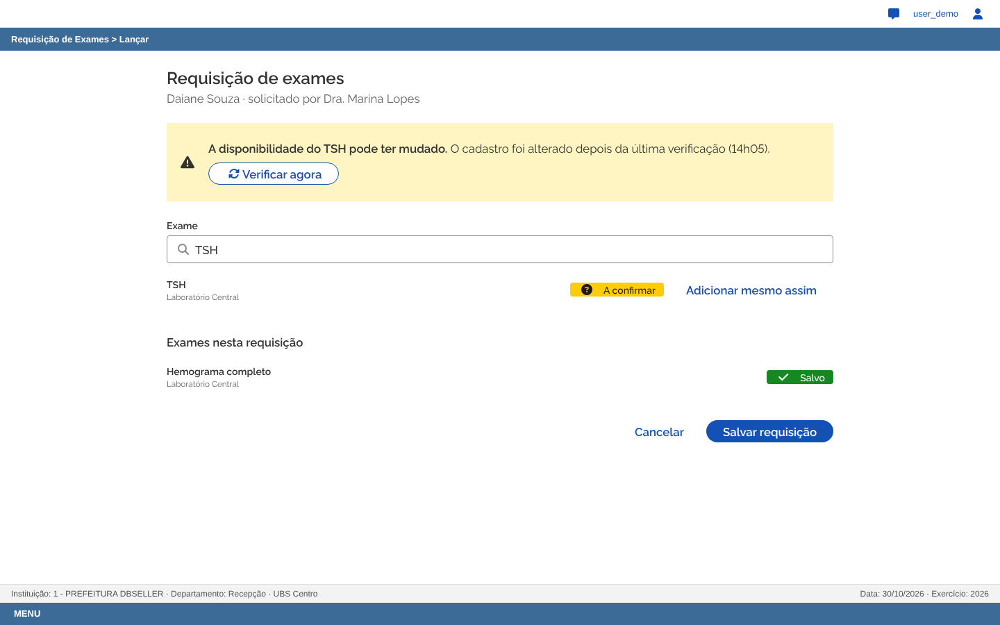 |
| Erro · Mensagem de erro · tipo contexto | 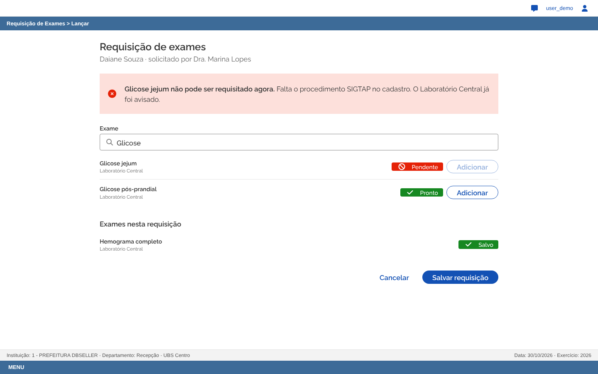 |
| Informação · Mensagem de informação · tipo sistema | 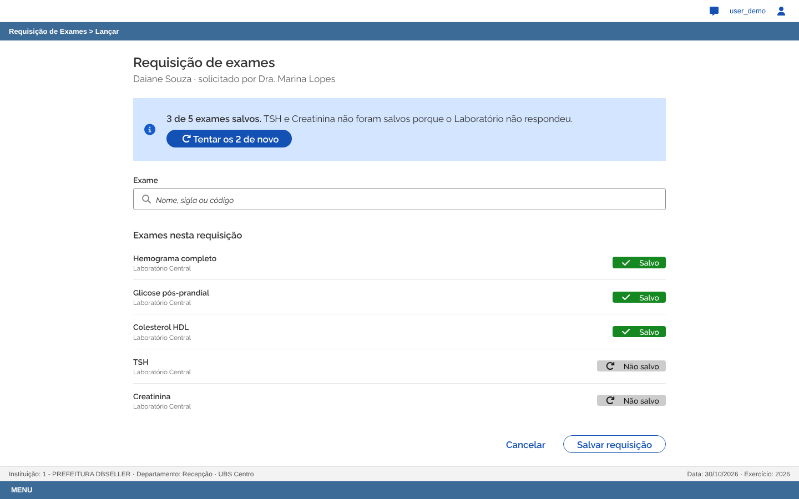 |
| Indisponível · Mensagem de erro · tipo sistema | 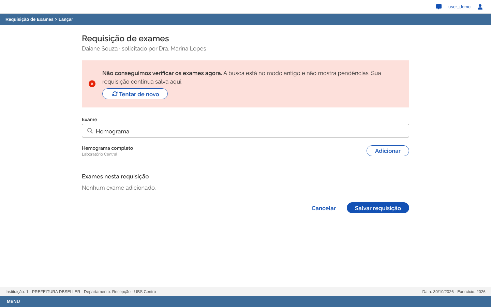 |

Dados de demonstração, fictícios.

## 5. Revisão do que a IA gerou

As telas foram construídas com ajuda de IA, e a IA erra: às vezes usa um componente do jeito errado, às vezes cria algo que contradiz o próprio objetivo da tela. Esta seção registra o que veio errado ao longo das versões, por que aquilo era um problema e o que foi corrigido. A revisão foi feita em rodadas: a cada versão, eu olhava as telas e apontava o que não estava funcionando (estava confuso, a estrutura não ajudava, não seguia o pacote do DS), e as correções foram feitas a partir desses apontamentos e conferidas contra os exemplos oficiais do DS.

| O que veio errado | Por que é problema | O que mudou |
|---|---|---|
| As primeiras versões mostravam os 7 estados empilhados numa página só, com números e etiquetas por cima da tela | Ficava confuso: não dava para ver uma tela inteira nem entender a diferença entre os estados | Uma tela por vez, escolhida por botões, com a explicação num quadro ao lado e não por cima |
| Layout em duas colunas, com a requisição num painel lateral e a prontidão num card ao lado do cadastro | Mais caixas do que a tarefa precisa; a leitura pulava de um lado para o outro | Uma coluna, na ordem do trabalho da recepção |
| CSS próprio mudando tamanho e estilo de mensagens, tags, abas e tabela | Fugia do DS: o mesmo componente pareceria diferente em outro serviço público | Componentes como o DS define; hierarquia e espaço com as classes utilitárias do DS |
| Fonte Raleway e ícones Font Awesome 5 no lugar dos oficiais | A fonte padrão do DS é a Rawline, e o DS 3.7 usa o Font Awesome 6 | Fonte e ícones do pacote oficial (`DS_govbr_completo/`) |
| Coluna `col-lg` do grid, que no DS só começa em 1280 px | O painel lateral caía para baixo da tela em telas comuns | Removido junto com as duas colunas |
| Botões primários demais na mesma tela | Com vários, o usuário não sabe qual é o próximo passo | Um primário por vez |
| Busca por "glicose" sugerindo "Glicemia capilar" como alternativa pronta | Sugeria à recepção trocar um exame por outro, que é decisão clínica, não dela | Trocado por "Glicose pós-prandial", e a mensagem não sugere substituto |
| Alertas em lugares diferentes conforme o estado (junto ao exame, acima da lista, dentro do campo, no topo) | A pessoa precisava procurar a mensagem a cada situação | Todo alerta foi para o mesmo lugar, abaixo do título; o item ou campo com problema só fica marcado |
| Mensagens longas, com horário, ramal e caminho de menu | A pessoa precisa ler demais para entender o que fazer | Mensagens de uma ou duas frases: o que aconteceu e o que fazer |

## 6. Ir além: segunda tela

A tela principal trata o momento em que o problema é **descoberto**, na recepção. Esta segunda tela volta um passo na jornada, para o momento em que o problema é **criado**, no cadastro do exame pelo laboratório, e trata um tipo de erro diferente: em vez de o sistema esconder algo (erro de contexto), aqui é o servidor que digita um dado inválido (erro de entrada), e a tela precisa ajudá-lo a corrigir antes que o problema chegue até a recepção.

**Tela:** Cadastro de Exame › aba Procedimento, na versão to-be. Na versão navegável (`telas/telas.html`), escolha "Cadastro (laboratório)" no topo.

**Por que outro tipo de erro.** Na tela principal, o erro tratado é **de contexto**: o sistema aplica uma regra (o filtro de prontidão) sem avisar e esconde o exame. Aqui o erro é **de entrada**: o servidor do laboratório digita um dado que não permite uma resposta útil (um código SIGTAP que não existe, um texto que corresponde a vários procedimentos, uma data inválida).

**Origem.**
- **Análise heurística da S2:** P2 (H5 Prevenção de erros, severidade 3), o exame vem ATIVO antes de ter material, procedimento e setor. Também P3 e P4 (severidade 3), cadastro incompleto sem aviso.
- **Blueprint to-be da S2:** etapas 2 a 4, com o aviso de prontidão no topo das telas do cadastro.
- **ATAM do grupo (§5.2.3):** falta a tática de validar a prontidão ao ativar (PS2, R01).

**Para quem e quando.** O servidor que cadastra exames no laboratório, na hora de vincular o procedimento SIGTAP. Hoje é aqui que nasce o problema que a recepção só descobre depois (P1).

**Os estados.**

| Estado | Mensagem do DS | O que a tela diz | Imagem |
|---|---|---|---|
| Erro no campo | Mensagem de erro + campo marcado | Enquanto a pessoa digita: "Código SIGTAP não encontrado. O código 0202010470 não existe na competência 10/2026. Confira os dígitos." | 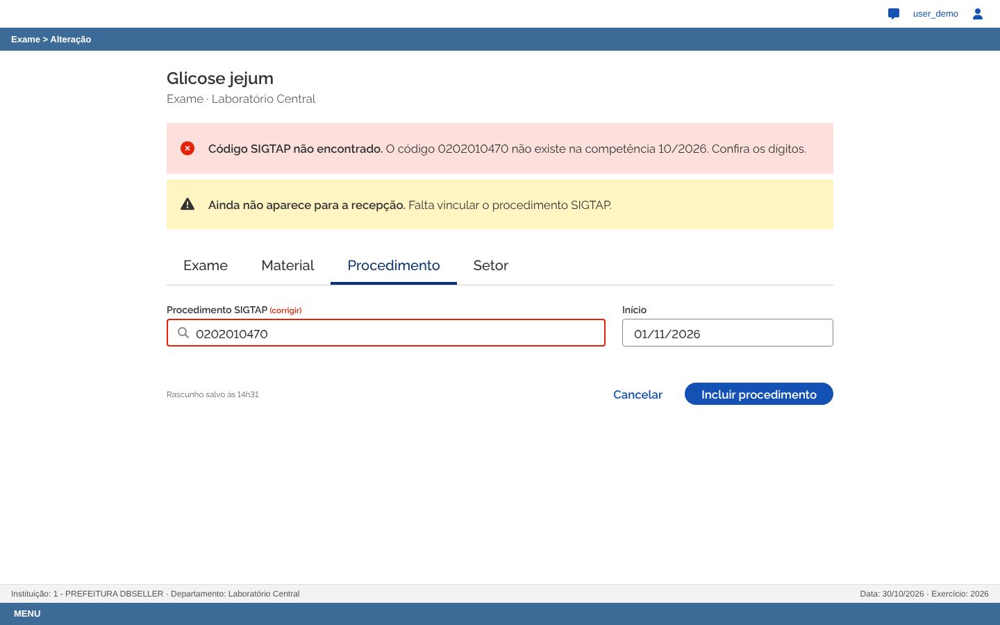 |
| Erro ao incluir | Mensagem de erro + campos marcados | "Procedimento não incluído. Procedimento SIGTAP: mais de um encontrado, escolha um da lista. Início: data inválida." Os dois campos ficam marcados, e nada do que foi digitado é apagado | 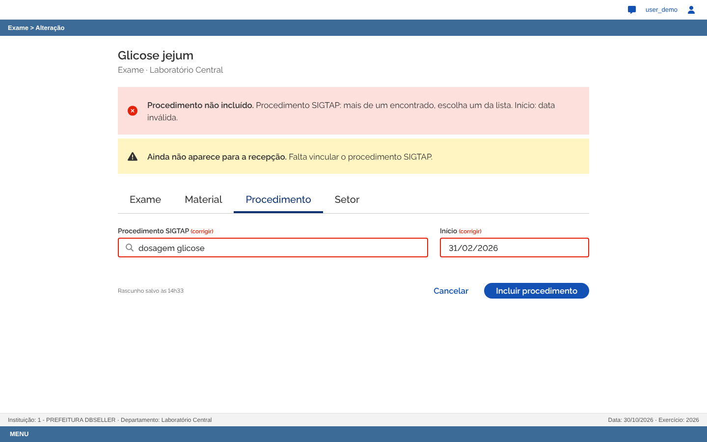 |
| Sucesso | Mensagem de sucesso | "Pronto para requisitar. A recepção já encontra este exame." | 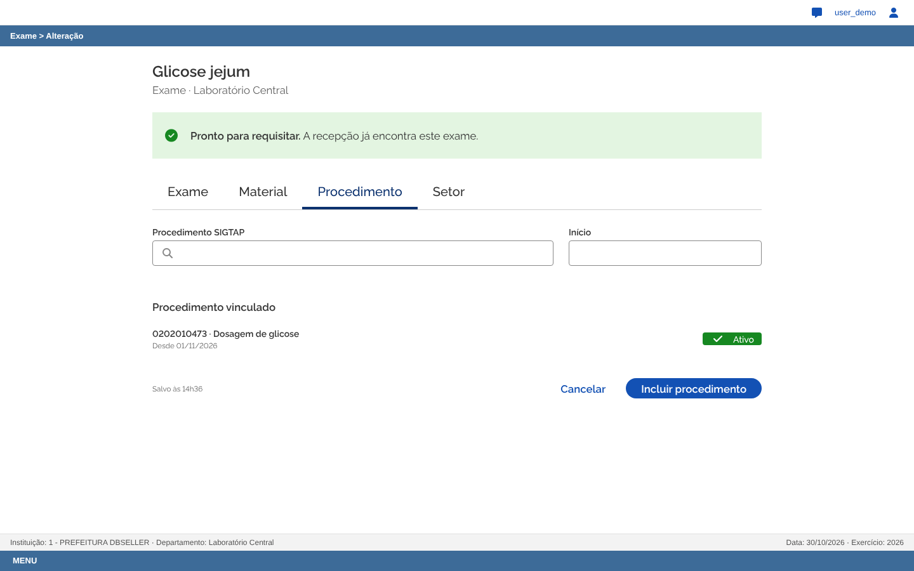 |

Nos dois estados de erro, logo abaixo do alerta de erro, a tela mantém o aviso de atenção "Ainda não aparece para a recepção. Falta vincular o procedimento SIGTAP.", que é o elemento do to-be que liga o cadastro à tela principal.

**As tratativas do slide "Formulários complexos":** validar durante (erro no campo), erro que preserva (erro ao incluir), estado de salvamento ("Rascunho salvo às 14h31") e contexto visível (o aviso de prontidão no topo).

**Ressalva honesta.** No to-be da S2, o formulário do cadastro continua no legado e só o aviso de prontidão é novo. Aqui redesenhei também a aba Procedimento com o DS, como exercício.

## 7. Declaração de uso de IA

Usei o Claude (Anthropic), no modo Cowork, como apoio ao longo de toda a ponderada, e quero deixar claro o que ele fez e o que foi decisão minha.

- **Leitura e organização:** o Claude leu o slide da aula, o repositório da S2 e o Projeto.md do grupo, e montou comigo o roteiro da atividade a partir do barema.
- **Evidência no e-Cidade:** depois que eu fiz o login no ambiente de demonstração, ele navegou até a Requisição de Exames, só lendo, sem gravar nada, e capturou os dois prints da seção 1.
- **Escolha da tela:** ele sugeriu trabalhar o P1 da minha avaliação heurística e a etapa 5 do to-be, mostrando os prós e contras em relação à primeira ideia que eu tinha (a sugestão de procedimento SIGTAP). A decisão de seguir com a Requisição foi minha.
- **Texto:** os rascunhos das seções foram escritos pelo Claude a partir do material da S2 e do ATAM, e revisados por mim, que também pedi os textos introdutórios de cada seção para deixar o documento mais claro.
- **Telas:** o HTML das telas foi gerado pelo Claude com o pacote oficial do DS gov.br que eu coloquei na pasta `DS_govbr_completo/`. Passamos por várias versões, e as mudanças de estrutura vieram dos meus apontamentos, como está registrado na seção 5.

O objetivo foi usar a IA para ganhar velocidade na pesquisa, na escrita e na construção das telas, mantendo comigo as escolhas sobre o problema, a tela e o que estava bom o suficiente para entregar.
